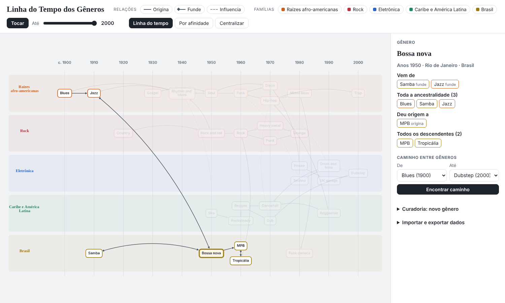

# Pesquisa sobre grafos: a linhagem dos gêneros musicais

Pesquisa em três partes sobre grafos, aplicada à história dos gêneros musicais: cada gênero é um vértice, e as arestas dizem de onde ele veio. O mesmo grafo, com 32 gêneros e 43 relações, é analisado em Python, guardado e consultado num banco de grafos e explorado numa página interativa.



## As três partes

1. **[Tecnologias](docs/1-tecnologias.md):** bibliotecas, bancos de dados, linguagens de consulta e ferramentas de visualização de grafos, como NetworkX, igraph, Neo4j, Gremlin, GQL e Cytoscape.js.
2. **[Contexto](docs/2-contexto.md):** por que a linhagem dos gêneros musicais é um grafo, o que são os vértices (gêneros) e as arestas (`origina`, `funde`, `influencia`).
3. **[Uso prático](docs/3-uso-pratico.md):** o grafo aplicado em três demonstrações, com os resultados.
    - Análise em Python com NetworkX.
    - Banco Neo4j consultado em Cypher.
    - Linha do tempo interativa com Cytoscape.js.

## Estrutura

```
pesquisa-grafos/
├── README.md
├── docs/
│   ├── 1-tecnologias.md
│   ├── 2-contexto.md
│   └── 3-uso-pratico.md
├── dados/
│   └── generos.json            gêneros, famílias e relações (fonte única)
├── python/
│   ├── analise_generos.py      análise com NetworkX
│   ├── test_analise.py         testes com unittest
│   ├── saida_exemplo.txt       saída da análise
│   └── requirements.txt
├── neo4j/
│   ├── 01-criar-grafo.cypher   cria vértices e arestas
│   └── 02-consultas.cypher     10 consultas
└── web/
    ├── index.html              linha do tempo com Cytoscape.js
    ├── app.js
    ├── dados.js
    ├── estilo.css
    └── captura.png
```

## Como rodar

**Python (NetworkX):**

```bash
cd python
pip install -r requirements.txt
python3 analise_generos.py
python3 -m unittest -v test_analise
```

**Neo4j:** execute `neo4j/01-criar-grafo.cypher` no Neo4j Browser e depois as consultas de `neo4j/02-consultas.cypher`.

**Página web:** abra `web/index.html` no navegador. É preciso internet na primeira vez, para baixar o Cytoscape.js.

## Dependências

| Parte | Dependência |
| --- | --- |
| Python | Python 3 e [NetworkX](https://networkx.org/) |
| Banco de dados | [Neo4j](https://neo4j.com/) (a edição Community basta) |
| Página web | [Cytoscape.js](https://js.cytoscape.org/), carregado por CDN |

## Sobre os dados

As décadas e linhagens são aproximadas: o acervo registra só as ligações principais de cada gênero.
