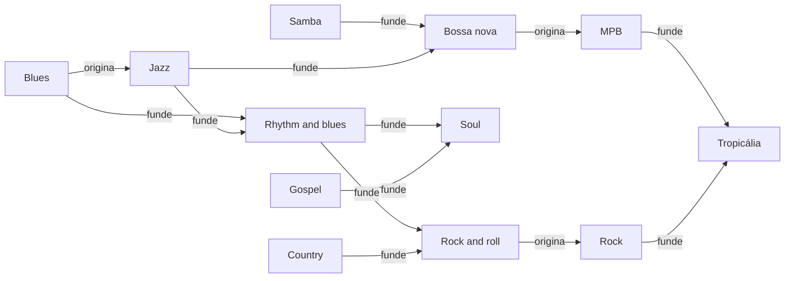

# Parte 2: Contexto, a linhagem dos gêneros musicais

Gêneros musicais nascem de outros gêneros: o rock and roll veio da mistura do rhythm and blues com o country, a bossa nova juntou o samba ao jazz, e o hip-hop saiu do funk e do disco. Essa história é uma rede de "quem veio de quem", e uma rede de relações é exatamente o que um grafo representa.

## Por que modelar como grafo

- **As perguntas são sobre ligações, não sobre linhas de tabela.** "De onde veio a bossa nova?" exige subir vários níveis de origem. Num banco relacional isso pede uma consulta recursiva; num grafo é só percorrer as arestas para trás.
- **Um gênero pode ter várias origens.** A fusão de dois gêneros vira duas arestas chegando no mesmo vértice, sem tabelas intermediárias.
- **A relação tem tipo.** Nascer diretamente de um gênero é diferente de ser influenciado por ele. No grafo, o tipo fica na própria aresta.
- **Existem caminhos.** Saber como o blues chegou ao dubstep é procurar um caminho entre dois vértices, um problema clássico de grafos.

## Vértices

Cada **vértice** é um gênero musical. O acervo tem 32 gêneros, de c. 1900 aos anos 2000.

| Atributo | Exemplo | Uso |
| --- | --- | --- |
| `id` | `bossa` | Identificador único |
| `nome` | Bossa nova | Nome exibido |
| `decada` | 1950 | Década aproximada de surgimento; também posiciona o gênero na linha do tempo |
| `lugar` | Rio de Janeiro | Onde surgiu |
| `familia` | brasil | Uma de cinco famílias: raízes afro-americanas, rock, eletrônica, Caribe e América Latina, Brasil |

## Arestas

Cada **aresta** é dirigida, sempre do gênero mais antigo para o mais novo, e tem um tipo. São 43 arestas.

| Tipo | Significado | Exemplo | Quantidade |
| --- | --- | --- | --- |
| `origina` | O destino nasceu diretamente da origem | Ska → Rocksteady | 15 |
| `funde` | O destino nasceu da mistura de dois gêneros; cada origem gera uma aresta | Samba → Bossa nova e Jazz → Bossa nova | 22 (11 fusões) |
| `influencia` | A origem marcou o destino, mas não é a origem dele | Dub → Hip-hop | 6 |

"Vem de" não é uma aresta à parte: é a leitura das arestas `origina` e `funde` ao contrário.

## Um trecho do grafo

O diagrama mostra 13 dos 32 gêneros, e cada seta traz o tipo da relação. O grafo completo está em `dados/generos.json`.

## Propriedades do modelo

- **Grafo dirigido:** a aresta tem sentido; "Blues origina Jazz" não é o mesmo que "Jazz origina Blues".
- **Grafo de propriedades:** vértices e arestas carregam atributos (década, lugar, tipo), como no modelo do Neo4j.
- **A linhagem é acíclica.** Considerando só `origina` e `funde`, nenhum gênero pode ser ancestral de si mesmo. Por isso a linhagem é um DAG (grafo dirigido acíclico), o que permite calcular uma ordem topológica: as "gerações" dos gêneros.
- **Regra de tempo:** uma aresta nunca vai de um gênero mais novo para um mais antigo.

## Perguntas que o grafo responde

| Pergunta | Problema de grafos |
| --- | --- |
| De onde veio a bossa nova? | Ancestrais de um vértice |
| O que o hip-hop gerou? | Descendentes de um vértice |
| Como o blues chegou ao dubstep? | Menor caminho entre dois vértices |
| Qual o ancestral comum mais recente da bossa nova e do rock and roll? | Menor ancestral comum |
| Quais gêneros geraram mais gêneros? | Tamanho do conjunto de descendentes |
| Quais gêneros ligam famílias diferentes? | Centralidade de intermediação |
| Em que ordem os gêneros podem ser listados respeitando as origens? | Ordenação topológica |
| Os dados têm erros, como um gênero que é ancestral de si mesmo? | Detecção de ciclos |

## Limites dos dados

As décadas e linhagens seguem a história da música mais aceita, mas são aproximadas e simplificadas. Gêneros surgem aos poucos e de várias fontes, e o acervo registra só as ligações principais de cada um.
