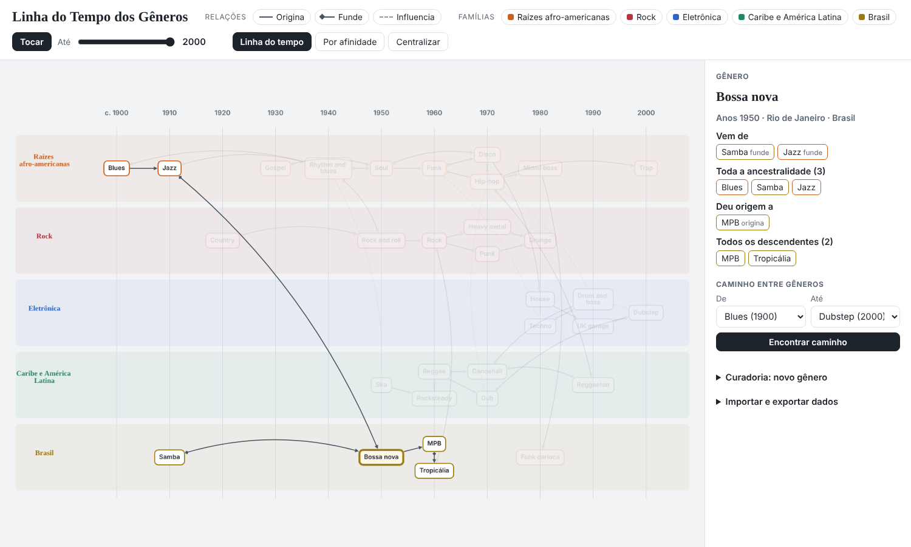

# Parte 3: Uso prático

O mesmo grafo de gêneros é usado em três demonstrações: uma análise em Python com NetworkX, um banco Neo4j consultado em Cypher e uma página interativa com Cytoscape.js. As três respondem às perguntas da Parte 2 e chegam aos mesmos resultados.

Os dados ficam em `dados/generos.json`. A página web usa uma cópia em `web/dados.js`, para abrir direto no navegador sem servidor.

## 1. Análise com NetworkX

O script `python/analise_generos.py` lê o JSON, monta dois grafos dirigidos (`DiGraph`) e roda as análises.

- **Grafo completo:** as 43 arestas.
- **Linhagem:** só `origina` e `funde`, as relações que definem de onde um gênero veio.

```bash
cd python
pip install -r requirements.txt
python3 analise_generos.py
python3 analise_generos.py --genero "Hip-hop" --de Samba --ate Tropicália
python3 -m unittest -v test_analise
```

| Análise | Função do NetworkX |
| --- | --- |
| Validar que a linhagem não tem ciclos | `nx.is_directed_acyclic_graph` |
| Gerações (ordem topológica em níveis) | `nx.topological_generations` |
| Ancestrais e descendentes | `nx.ancestors`, `nx.descendants` |
| Menor caminho | `nx.shortest_path` |
| Gêneros-ponte | `nx.betweenness_centrality` |
| Maior cadeia de linhagem | `nx.dag_longest_path` |

Trecho da saída, sem argumentos (a saída completa está em `python/saida_exemplo.txt`):

```
2. Validação
Linhagem sem ciclos (DAG): True
Relações que voltam no tempo: 0

4. De onde vem e o que gerou: Bossa nova
Ancestrais: Blues, Jazz, Samba
Descendentes: MPB, Tropicália

5. Caminho de Blues até Dubstep
Só linhagem (6 passos): Blues --funde--> Rhythm and blues --funde--> Soul --funde--> Disco --origina--> House --origina--> UK garage --funde--> Dubstep
Com influências (6 passos): Blues --funde--> Rhythm and blues --funde--> Soul --origina--> Funk --funde--> Hip-hop --influencia--> Drum and bass --influencia--> Dubstep

6. Ancestral comum mais recente: Bossa nova e Rock and roll
Jazz (1910)

9. Maior cadeia de linhagem
9 gêneros: Blues -> Jazz -> Rhythm and blues -> Soul -> Funk -> Disco -> House -> UK garage -> Dubstep
```

O que os resultados mostram:

- **Blues tem 21 descendentes**, dois terços do acervo. É a raiz mais produtiva.
- **Hip-hop, Soul e Rhythm and blues** têm a maior centralidade de intermediação: são os gêneros por onde mais passam os caminhos entre famílias diferentes.
- **Ska e Techno aparecem como raízes da linhagem**, porque no acervo só recebem influências, não origens.

O arquivo `python/test_analise.py` tem 11 testes com `unittest`. Eles conferem o tamanho do grafo, a ausência de ciclos e de relações que voltam no tempo, ancestrais, caminhos e o ancestral comum. Também testam, num grafo pequeno de três vértices, se o código detecta um ciclo e uma relação fora de ordem.

## 2. Banco de grafos com Neo4j

O grafo vira um banco com dois rótulos de vértice e quatro tipos de relacionamento:

```
(:Genero {id, nome, decada, lugar})-[:DA_FAMILIA]->(:Familia {id, nome})
(:Genero)-[:ORIGINA | :FUNDE | :INFLUENCIA]->(:Genero)
```

Para carregar, abra o Neo4j Browser (ou o `cypher-shell`) e execute `neo4j/01-criar-grafo.cypher`. Depois rode as consultas de `neo4j/02-consultas.cypher`, na ordem da tabela.

| # | Pergunta | Ideia da consulta | Resultado esperado |
| --- | --- | --- | --- |
| 1 | De onde veio a Bossa nova? | Caminho de tamanho variável `<-[:ORIGINA\|FUNDE*1..]-` | Blues (1900), Jazz (1910), Samba (1910) |
| 2 | O que o Hip-hop gerou? | O mesmo padrão no outro sentido | Funk carioca, Miami bass, Reggaeton, Trap |
| 3 | Como o Blues chegou ao Dubstep? | `shortestPath` só por ORIGINA e FUNDE | Blues → Rhythm and blues → Soul → Disco → House → UK garage → Dubstep, 6 passos |
| 4 | Ancestral comum mais recente de Bossa nova e Rock and roll | Vértice que alcança os dois, ordenado pela década | Jazz (1910) |
| 5 | Quais gêneros são fusões? | Dois `FUNDE` chegando no mesmo vértice | 11 fusões, de Rhythm and blues (Blues + Jazz) a Dubstep (Dub + UK garage) |
| 6 | Quem tem mais descendentes? | `count(DISTINCT d)` sobre o caminho variável | Blues 21, Jazz 20, Rhythm and blues 17, Gospel 11, Soul 10 |
| 7 | Quantos gêneros por família? | Agrupamento por `:Familia` | Raízes afro-americanas 10; Caribe e América Latina 6; Rock 6; Brasil 5; Eletrônica 5 |
| 8 | Quais são as raízes da linhagem? | `NOT EXISTS` de aresta chegando | Blues, Samba, Country, Gospel, Ska, Techno |
| 9 | Alguma relação volta no tempo? | `a.decada > b.decada` | Nenhuma linha |
| 10 | Existe ciclo na linhagem? | Caminho que começa e termina no mesmo vértice | Nenhuma linha |

Os resultados esperados foram conferidos com o NetworkX sobre o mesmo JSON. As consultas 9 e 10 são as validações do modelo: se alguém cadastrar um dado errado, elas passam a devolver linhas.

## 3. Linha do tempo interativa com Cytoscape.js

A pasta `web/` tem uma página que desenha o grafo sobre um eixo de décadas, com uma faixa por família. Para usar, basta abrir `web/index.html` no navegador; é preciso internet na primeira vez, para baixar o Cytoscape.js.



| Recurso da página | Recurso do Cytoscape.js |
| --- | --- |
| Gêneros posicionados por década e família | Layout `preset` com posições calculadas |
| Visão por afinidade | Layout `cose`, por força |
| Clique mostra ancestrais e descendentes | `incomers()`, `outgoers()` e classes de estilo |
| Filtros por tipo de relação e por família | Seletores, como `edge[tipo = 'influencia']` |
| Caminho entre dois gêneros | `aStar({ directed: true })` |
| Botão "Tocar", que revela os gêneros década a década | Mudança de visibilidade por `data('decada')` |
| Cadastro de gênero novo, com validação de tempo e de ciclo | `cy.add()` depois da validação |
| Importar e exportar JSON | `cy.elements()` e leitura de arquivo |

Por padrão, a página inclui as influências nas consultas. Por isso o caminho do Blues ao Dubstep pode sair diferente do caminho só por linhagem; desligar "Influencia" no filtro reproduz o resultado das outras duas demonstrações.
